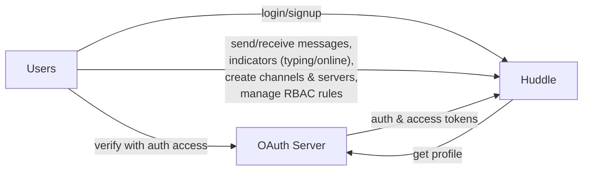
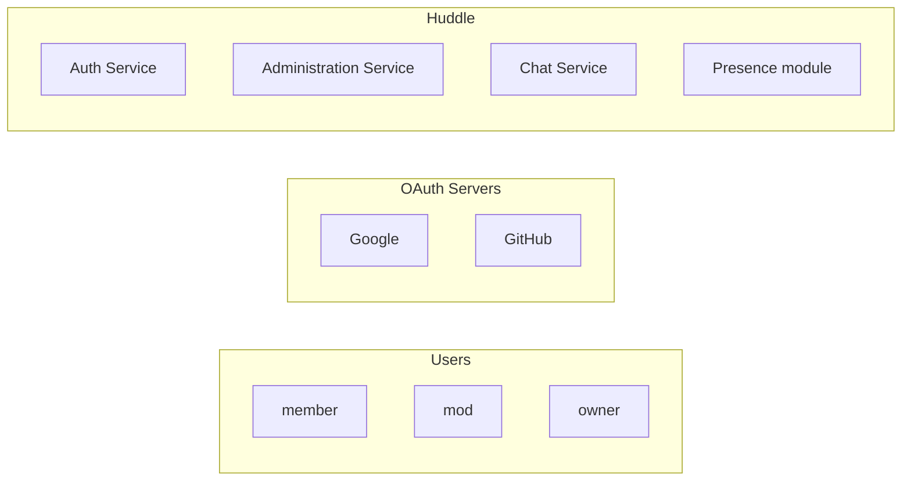
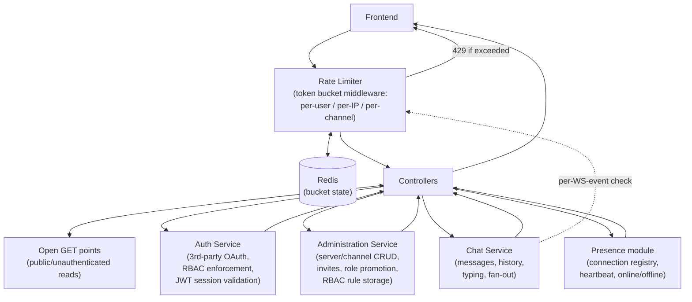

# Software Architecture — Huddle

**Status:** Draft (module split locked: Auth, Administration, Chat, Presence)
**Date:** 2026-08-22

---

## 1. High-Level Flow

- **Users ↔ Huddle**: login/signup, send/receive messages, live indicators (typing, online), create channels & servers, manage RBAC rules.
- **Users ↔ OAuth Server**: delegated auth — user authorizes via the provider directly.
- **Huddle ↔ OAuth Server**: Huddle exchanges the auth code for the user's profile plus access/refresh tokens.

Single backend (not literal microservices — free/local, single-instance scale), internally split into modules by responsibility, following the same boundaries industry chat platforms use at larger scale (see Section 5).

---

## 2. Detailed — Component Contents

- **Users**: three roles — `member`, `mod`, `owner`.
- **OAuth Servers**: pluggable providers — Google, GitHub.
- **Huddle**: four internal modules — Auth Service, Administration Service, Chat Service, Presence module.

---

## 3. Huddle Breakdown — Internal Request Flow

- Frontend calls the **Rate Limiter** first; requests within budget pass through to Controllers, requests over budget get a `429` (REST) or a dropped-event error frame (WS) without reaching Controllers.
- Rate Limiter checks/updates token buckets in **Redis** — shared state, so limits hold correctly even if Huddle later runs more than one instance.
- Controllers respond back to Frontend.
- Controllers depend on Auth Service, Administration Service, Chat Service, and Presence module.
- "Open GET points" bypass the *auth* gate (still pass through the rate limiter) for public/unauthenticated reads.
- Chat Service re-checks the Rate Limiter per WS event/frame (message send, typing) since those don't arrive as discrete HTTP requests — see Section 4.1.

---

## 4. Module Breakdown

| Module | Owns |
|---|---|
| **Auth Service** | OAuth provider integration (Google, GitHub — pluggable), auth session/JWT issuance & validation, RBAC *enforcement* (declarative, e.g. decorators on route handlers) |
| **Administration Service** | Server & channel CRUD, invite link lifecycle (generate/revoke/regenerate), role promotion (member → mod), RBAC *rule storage* (channel-creation policy, channel-level overrides) |
| **Chat Service** | Messages (post/edit/soft-delete), history pagination, typing indicator, real-time fan-out to channel subscribers |
| **Presence module** | Connection registry (userId → connectionId/lastHeartbeat), heartbeat handling, online/offline state, live presence broadcast |
| **Rate limiter** | Cross-cutting middleware at the Controller/Gateway layer — not a peer service. Token-bucket, Redis-backed, per-user/per-IP/per-channel (see Section 4.1) |

**Auth vs. Administration split:** Auth enforces permission checks; Administration owns the permission rules themselves (who can create channels, mod list, channel overrides). Mirrors Slack's separation of real-time layer from membership/business-logic data.

**Why Administration is not inside Chat Service:** Chat is high-frequency, real-time, fan-out-shaped (one message → broadcast to N subscribers). Administration is low-frequency, transactional CRUD. Different load profile, different failure blast-radius — bundling them couples scaling/deploy characteristics unnecessarily. Same boundary Slack draws between its real-time "channel server" and its business-logic "web app," and the same boundary Discord draws between its Gateway/messaging path and account/guild management.

**Auth session vs. Presence — why they're separate modules, not the same "session":**

| | Auth Service (auth session) | Presence module (connection session) |
|---|---|---|
| Answers | "Who is this request from, and are they logged in?" | "Is this user connected and active *right now*?" |
| Backed by | JWT (or signed cookie), issued at login | In-memory map (or Redis), mutated live |
| Lifetime | Hours/days — token validity | Seconds — heartbeat window (~30s) |
| Written on | Login / logout | WS connect / heartbeat / disconnect |
| Storage need | None (stateless verify), or a small revocation list | Must be stored and mutated continuously |
| Cardinality | One per login | One per active connection (multiple per user across tabs/devices) |

Auth Service is consulted once, at WS handshake, to validate the JWT. From then on, the **Presence module** owns and mutates the live connection registry — it's the thing that changes constantly and drives the green-dot broadcast, so it needs its own storage concern independent of the auth token's lifecycle.

### 4.1 Rate Limiter — Decided Design

**Algorithm:** token bucket, matching Discord's own approach — allows bursts (e.g. pasting a few messages quickly) while capping sustained abuse, rather than a hard fixed-window cliff.

**Dimensions:**

| Dimension | Applies to | Notes |
|---|---|---|
| Per-user | All authenticated routes/WS events | Primary key once identity is known |
| Per-IP | Pre-auth routes (login, OAuth callback) | No user id yet; stops credential-stuffing/spam signups |
| Per-channel | Message-send | Caps one user flooding a single channel's ~200 watchers, independent of their global per-user budget |

**Buckets (starting budgets, tunable):**

| Route class | Bucket |
|---|---|
| Message send | ~5 tokens burst, refill ~1/sec |
| Typing indicator | cheap bucket + server-side debounce (don't fan out every keystroke) |
| Login / OAuth callback (per-IP) | strict, e.g. 5/min |
| Invite regenerate, role promotion | strict, e.g. 3/min |
| Reads (history, Open GET points) | generous |

**Storage: Redis**, from day one. Chosen over in-memory so bucket state is centralized and correct even if Huddle later runs more than one instance — avoids a rework later, at the cost of a Redis dependency now (acceptable: Redis has a free tier and runs locally at zero cost, consistent with NFR-10).

**Enforcement point:** middleware in front of Controllers for REST; checked inline in Chat Service on each incoming WS event/frame (same bucket logic, invoked per-frame instead of per-HTTP-request).

**Client feedback:**
- REST: `429` + `Retry-After` header, mirroring Discord's pattern of exposing rate-limit state so clients can back off proactively.
- WS: an error frame scoped to the offending event (message dropped, not the connection) — repeated violations within a window escalate to a disconnect.

---

## 5. Industry Precedent

**Discord**
- Polyglot backend (~20 Elixir microservices for real-time chat infra, Python for HTTP API, Rust for data services, C++ for voice/video).
- Dedicated **Presence** service tracks user sessions/online status, backed by Redis clusters across regions — separate from account/guild management.
- **Gateway** is the single entry point managing authentication, persistent WebSocket connections, and event routing.
- Custom session-resumption buffers prevent reconnection storms from crushing the database.

**Slack**
- Splits **real-time message propagation** (the "channel server") from **business logic/storage/auth** (the "web app") — analogous to how game servers separate real-time events from game logic.
- **Channel membership** is its own concern/store, so each client only syncs the channels it's subscribed to — improves reliability and startup time at scale.

**Rate limiting**
- Discord: per-route token buckets per user/bot, plus a global 50 req/s backstop; rate-limit state communicated via response headers (`X-RateLimit-Bucket`, `X-RateLimit-Scope`) so clients back off proactively. ([Discord docs](https://docs.discord.com/developers/topics/rate-limits))
- General pattern: enforced at the gateway/edge or as middleware in front of services, backed by shared state (Redis) — Huddle adopts this from day one (Section 4.1) rather than deferring it.
- Becomes its own standalone service only when policies are complex/multi-tenant/ML-driven — not applicable at Huddle's target scale (~1,000 concurrent users, single instance); Redis-backed middleware is sufficient.

---

## 6. Roles Reference

- **Users**: `member`, `mod`, `owner` (server-scoped; authority defined at server level, never overridden by a channel).
- **OAuth Servers**: Google, GitHub (pluggable, per PRD FR-3).

---

## 7. Open Questions

- Final storage choice for Presence's connection registry (in-memory vs. Redis) — now that Redis is already in the stack for rate limiting, worth revisiting whether Presence should share it for consistency.
