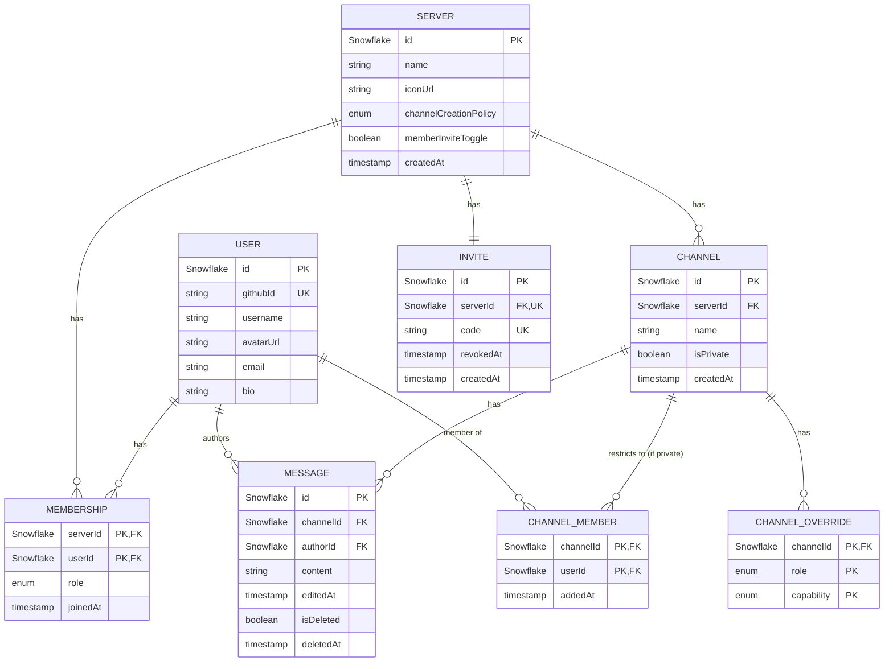

# Data Model & ERD

**Status:** Draft
**Date:** 2026-08-22
**Parent doc:** [CompleteApp.md](./CompleteApp.md)

---

## 1. Scope

This doc is the authoritative **Postgres relational schema** for Huddle — the entities and relationships referenced conceptually across [auth-service.md](./auth-service.md), [administration-service.md](./administration-service.md), and [chat-service.md](./chat-service.md), now finalized.

Out of scope (owned elsewhere, not modeled here):
- **Sessions** — Redis-only, keyed by opaque session ID ([auth-service.md §3](./auth-service.md)).
- **Rate-limit buckets** — Redis-only ([rate-limiter.md](./rate-limiter.md)).
- **Presence registry** — Redis-only ([presence-module.md §2](./presence-module.md)).
- **Message send idempotency keys** — ephemeral (30s retention), Redis-only ([chat-service.md §4](./chat-service.md)), not persisted alongside the Message row.

---

## 2. ID Strategy

**Snowflake IDs for every independent entity**: `User`, `Server`, `Channel`, `Invite`, `Message` — generated via `@sapphire/snowflake` (already adopted for Message in [chat-service.md §3](./chat-service.md), extended here to all entities).

Rationale:
- One ID-generation utility and one column type reused everywhere — no mixing UUID/serial with Snowflake across tables.
- Sortable by creation order for free (see §3 on `createdAt`).
- Matches the project's Discord-authenticity framing.

**Join/rule tables use composite primary keys, not Snowflake IDs** — `Membership`, `ChannelMember`, `ChannelOverride` are never referenced by their own row identity, only ever looked up by their natural key (e.g. "this user in this server"), so a surrogate ID would be pure overhead.

---

## 3. `createdAt` Convention

- **Message**: no `createdAt` column — decoded from its Snowflake ID when needed ([chat-service.md §3](./chat-service.md)).
- **User**: no `createdAt` column — no feature reads a user's join date.
- **Server, Channel, Invite**: explicit `createdAt` column — each has a plausible listing/ordering use case (server list, flat channel list, invite regeneration timing), and an explicit column reads more naturally in queries than decoding a Snowflake each time.

---

## 4. Entities

### 4.1 User

| Column | Type | Notes |
|---|---|---|
| `id` | Snowflake (PK) | |
| `githubId` | string, unique | Source of truth; immutable |
| `username` | string | Re-synced from GitHub on every login |
| `avatarUrl` | string | Re-synced from GitHub on every login |
| `email` | string | Captured, currently unused |
| `bio` | string, nullable | ≤300 chars, user-set (not GitHub-synced) |

### 4.2 Server

| Column | Type | Notes |
|---|---|---|
| `id` | Snowflake (PK) | |
| `name` | string | Not globally unique — multiple servers can share a name |
| `iconUrl` | string, nullable | URL only; no file-upload/hosting (deferred) |
| `channelCreationPolicy` | enum(`owner_only`, `everyone`, `mods_only`) | Owner-configurable, [administration-service.md §3](./administration-service.md) |
| `memberInviteToggle` | boolean | Whether ordinary Members can share the invite link |
| `createdAt` | timestamp | |

### 4.3 Membership

Join table: server membership + role. No surrogate ID.

| Column | Type | Notes |
|---|---|---|
| `serverId` | Snowflake (FK → Server) | |
| `userId` | Snowflake (FK → User) | |
| `role` | enum(`owner`, `moderator`, `member`) | |
| `joinedAt` | timestamp | |

**Keys:**
- PK: `(serverId, userId)`
- Partial unique index: `UNIQUE (serverId) WHERE role = 'owner'` — enforces exactly one owner per server. Ownership transfer is a single transaction flipping both the old and new owner's `role`.
- Index: `(userId)` — "which servers does this user belong to."

### 4.4 Channel

| Column | Type | Notes |
|---|---|---|
| `id` | Snowflake (PK) | |
| `serverId` | Snowflake (FK → Server) | Cascade delete with Server (hard delete) |
| `name` | string | Unique per server |
| `isPrivate` | boolean | |
| `createdAt` | timestamp | |

**Keys:** `UNIQUE (serverId, name)`.

**Deletion:** hard delete — cascades to the channel's Messages and any ChannelOverride/ChannelMember rows, consistent with Server's hard-delete behavior ([administration-service.md §2](./administration-service.md)).

### 4.5 ChannelMember

Private-channel membership only. Join table, no surrogate ID.

| Column | Type | Notes |
|---|---|---|
| `channelId` | Snowflake (FK → Channel) | |
| `userId` | Snowflake (FK → User) | |
| `addedAt` | timestamp | |

**Keys:** PK `(channelId, userId)`. Rows only exist for private channels — a public channel has no rows here (visibility is implied by server membership).

### 4.6 ChannelOverride

Tighten-only capability override. Join/rule table, no surrogate ID.

| Column | Type | Notes |
|---|---|---|
| `channelId` | Snowflake (FK → Channel) | |
| `role` | enum(`moderator`, `member`) | Owner is never overridden — always full capability |
| `capability` | enum(`view`, `post`, `delete_others`, `manage_settings`) | [administration-service.md §4](./administration-service.md) |

**Keys:** PK `(channelId, role, capability)`.

**Semantics:** row **existence** = that capability is **revoked** for that role in that channel. No row = inherits the server-wide default for that role. There is no "value" column — overrides can only tighten, so presence alone is sufficient; there's no way to represent a grant here.

### 4.7 Invite

Single active invite per server — one row per server, updated in place on regenerate.

| Column | Type | Notes |
|---|---|---|
| `id` | Snowflake (PK) | |
| `serverId` | Snowflake (FK → Server), unique | One invite row per server |
| `code` | string, unique | Overwritten on regenerate ("same slot, new code") |
| `revokedAt` | timestamp, nullable | Set when explicitly revoked without regenerating |
| `createdAt` | timestamp | |

### 4.8 Message

| Column | Type | Notes |
|---|---|---|
| `id` | Snowflake (PK) | `createdAt` derived from this |
| `channelId` | Snowflake (FK → Channel) | |
| `authorId` | Snowflake (FK → User) | |
| `content` | string | ≤2048 chars, stripped |
| `editedAt` | timestamp, nullable | |
| `isDeleted` | boolean | Soft delete |
| `deletedAt` | timestamp, nullable | |

**Keys:** Index `(channelId, id)` — supports cursor-based pagination and reconnect catch-up ([chat-service.md §5–6](./chat-service.md)), since `id` is a sortable Snowflake.

---

## 5. Relationships

| Relationship | Cardinality | Via |
|---|---|---|
| User ↔ Server | many-to-many | `Membership` |
| Server → Channel | one-to-many | `Channel.serverId` |
| Server ↔ Invite | one-to-one | `Invite.serverId` (unique) |
| Channel → Message | one-to-many | `Message.channelId` |
| User → Message | one-to-many (author) | `Message.authorId` |
| Channel ↔ User | many-to-many (private channels only) | `ChannelMember` |
| Channel → ChannelOverride | one-to-many | `ChannelOverride.channelId` |

---

## 6. ERD

---

## 7. Open Questions / Future Enhancements

- Invite **expiration**/**max-use** limits ([administration-service.md §7](./administration-service.md)) would add columns to `Invite` (`expiresAt`, `maxUses`, `useCount`) — not built now.
- Whether `ChannelOverride` needs a `createdBy`/`updatedAt` audit trail — not raised as a requirement, revisit if needed.
- Full Prisma schema syntax (this doc is the conceptual model; translating to `schema.prisma` is an implementation step, not a design decision).
