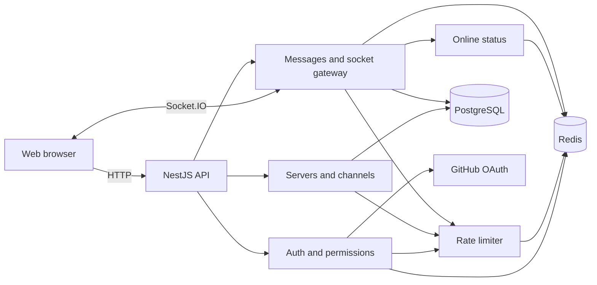

# Backend architecture

Huddle's backend is one NestJS application. Its folders divide the work by feature. They are not separate services or deploys.

## Main components

- **Auth** signs users in with GitHub and resolves the signed-in user from a session cookie.
- **Administration** manages servers, memberships, invites, channels, private-channel members, and channel permission overrides.
- **Chat** stores messages and history. Its Socket.IO gateway manages channel rooms and sends live events.
- **Presence** tracks each active socket and reports when a user comes online or goes offline.
- **Rate limiter** applies shared token buckets to HTTP routes and socket events.
- **Common** provides configuration, validation, errors, logging, Snowflake IDs, and Postgres and Redis connections.

## A normal request

An HTTP request passes through validation, session authentication, any permission guard, and a rate-limit check before the controller calls a service. Services apply product rules through repository ports. Adapters connect those ports to Prisma/Postgres or Redis. Controllers return the response.

Socket.IO is the transport exception: the gateway owns socket connections, rooms, and broadcasts. It uses the same chat service, permission rules, and rate limiter as HTTP.

The `@huddle/contracts` workspace contains public HTTP and socket data shapes shared by the API and web app. IDs cross the network as strings, even though the database stores them as 64-bit integers.
