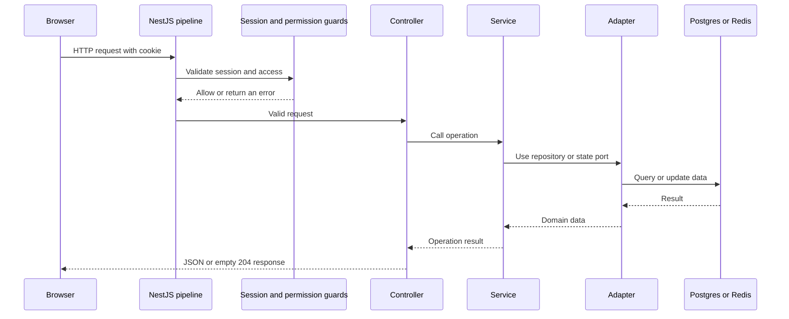
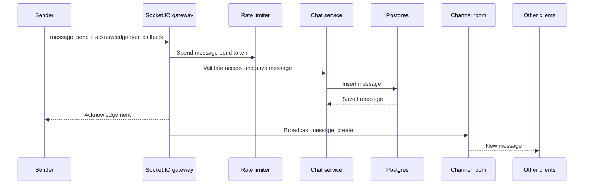

# Communication between components

This guide shows how parts of Huddle exchange information. It complements [flows.md](flows.md), which follows user actions.

## HTTP request

## Live message

## Access change

Administration writes the membership, private-channel member, or override change to Postgres. It emits an internal application event. The gateway checks connected users' current access, updates their channel rooms, then sends `channel_added`, `channel_removed`, or `membership_changed` notices. The API does not trust a client's previous permissions for later operations.

## Storage roles

- **Postgres** stores accounts, servers, memberships, channels, invites, overrides, and messages.
- **Redis** stores sessions and short-lived coordination state such as rate-limit buckets, active socket presence, and chat retry keys.
- **GitHub** verifies OAuth sign-in and supplies the profile synced by Huddle.
