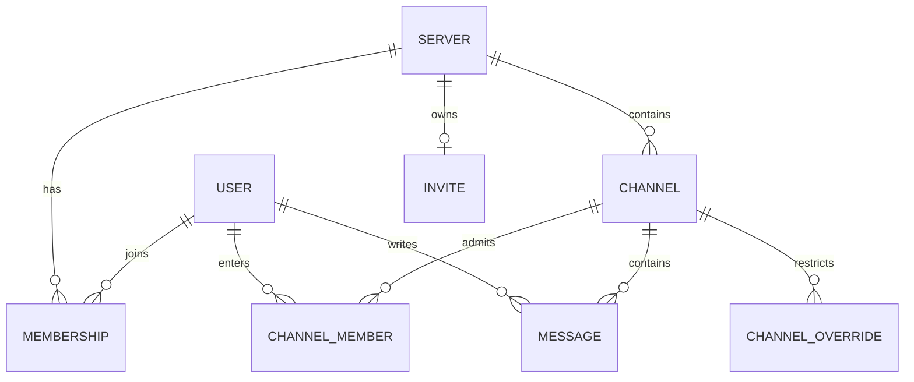

# Database

Postgres stores durable application records. Prisma defines the schema in `apps/api/prisma/schema.prisma`. Prisma migrations change the database in recorded steps. Redis state is described in [caching.md](caching.md), not stored in these tables.

## Models

| Model | Stored fields | Meaning |
|---|---|---|
| `User` | `id`, `githubId`, `username`, `avatarUrl`, `email`, optional `bio`, optional `deletedAt` | GitHub identity and profile. Deleted accounts are marked, not removed. |
| `Server` | `id`, `name`, optional `iconUrl`, `channelCreationPolicy`, `memberInviteToggle`, `createdAt` | A community and its server-wide settings. |
| `Membership` | `serverId`, `userId`, `role`, `joinedAt` | A person's membership and server role. Composite key: server and user. |
| `Channel` | `id`, `serverId`, `name`, `isPrivate`, `createdAt` | A conversation inside a server. Names are unique within a server. |
| `ChannelMember` | `channelId`, `userId`, `addedAt` | Explicit access for a private-channel member. Public channels need no rows. |
| `ChannelOverride` | `channelId`, `role`, `capability` | A row means that capability is revoked for that role in that channel. |
| `Invite` | `id`, `serverId`, `code`, optional `revokedAt`, `createdAt` | One invite record per server; regeneration updates its code. |
| `Message` | `id`, `channelId`, `authorId`, `content`, optional `editedAt`, `isDeleted`, optional `deletedAt` | Chat history. Deleting a message keeps the row and removes its content. |

Every independent entity ID is a Snowflake stored as a Postgres `BigInt`. IDs are strings in JSON because JavaScript numbers cannot safely represent all 64-bit IDs. `User` and `Message` have no `createdAt` column; their creation time is decoded from the ID. The API formats message times as ISO strings.

The schema enforces unique GitHub IDs, one owner per server, one invite per server, unique invite codes, and unique channel names per server. A message index supports channel history ordered by ID. Deleting a server or channel cascades to its owned records. User references are restricted so history is not accidentally lost.

## Migrations and local database

Use `npm run db:migrate` to create/apply a development migration. Use `npm run db:migrate:deploy` to apply existing migrations without creating one. Never hand-edit migration files or use `prisma db push`; migration history must remain reproducible. Prisma 7 reads `DATABASE_URL` from `apps/api/prisma.config.ts` and generates its client under `apps/api/src/generated/prisma`.
