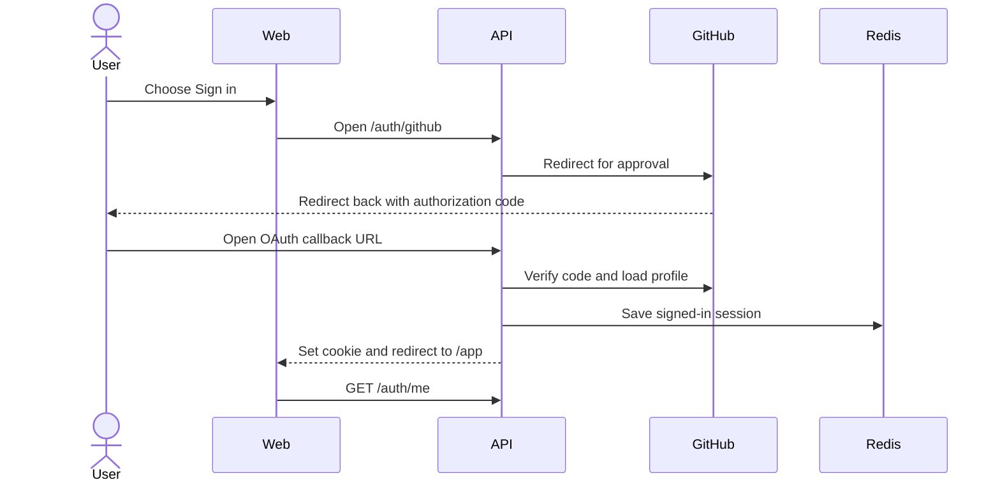

# Main user flows

These diagrams show what a person does and what the app does next. For messages between technical components, see [communication.md](communication.md).

## Sign in

## Join a server

1. A signed-in person opens an invite link.
2. Huddle shows the small server preview.
3. The person chooses Join.
4. Huddle adds their membership. The web app refreshes the server and channel lists.

## Create and manage a channel

1. A member's role and the server's channel-creation policy decide whether they may create a channel.
2. Owners and moderators may create private channels. They can add or remove server members from the channel.
3. Owners and moderators can revoke channel capabilities for a role. Removing an override restores the server default. An override cannot grant a capability.
4. Channel visibility and access changes are reconciled with connected users in real time.

## Send and read messages

1. The web app loads the newest history page when a channel opens.
2. Sending uses the socket by default. The server validates, rate-limits, checks access, stores the message in Postgres, acknowledges the sender, and broadcasts to the channel.
3. The transcript combines saved history, live events, and pending sends. If socket sending is unavailable, the client can use the REST message endpoint.
4. On reconnect, the client asks for messages after its last known ID. If a catch-up page is truncated, it reloads history to avoid a gap.

## Presence

1. A signed-in socket connection is registered for its user.
2. The client gets an initial snapshot for relevant peers.
3. Socket heartbeats keep the connection active. Huddle broadcasts online/offline changes when a user's first connection opens or last one closes.
