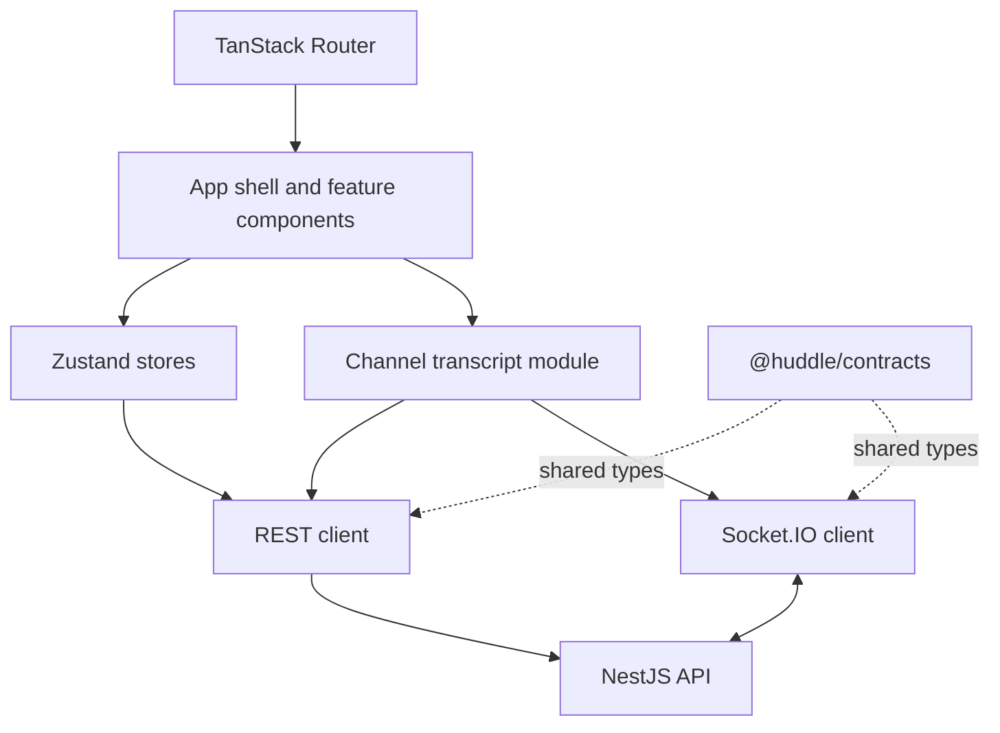

# Frontend architecture

The web app is a React single-page application. TanStack Router selects a page, React components display it, Zustand stores hold shared client state, and API modules talk to the backend.

## Main parts

- **Routes and layout:** the landing page, protected app, server and channel views, settings, and invite preview are defined in `apps/web/src/router.tsx`. `AppShell` coordinates the server list, channel list, member sidebar, and mobile navigation.
- **Feature components:** `components/` groups auth, chat, channels, servers, settings, and layout UI.
- **Stores:** Zustand stores keep auth, servers, channels, memberships, presence, socket status, and UI state. They avoid passing shared state through many component layers.
- **REST client:** `api/client.ts` sends JSON requests with browser credentials. `VITE_API_URL` selects a separate API origin; an empty value uses the current page origin.
- **Socket client:** `api/socket.ts` owns one Socket.IO connection and its reconnect and handshake-refusal behavior.
- **Channel transcript:** `transcript/channelTranscript.ts` coordinates history pages, live socket events, send acknowledgements, reconnect catch-up, and REST fallback. `messageStore.ts` holds the displayed message rows.

The backend remains the authority for access. Client capability data controls which actions are shown, but the server checks each protected request again.
